# Plataforma de gestión de proyectos colaborativos (Práctica final 3.9)

Aplicación en Laravel donde los usuarios crean proyectos y añaden participantes con un rol y sus horas de trabajo. Solo el propietario de un proyecto puede editarlo, borrarlo y cambiar su equipo.

## Capturas

Hechas con los datos de prueba del seeder (entrando como `ana@example.com`).

### Portada y usuarios

| Portada (sin sesión) | En el móvil |
|---|---|
| 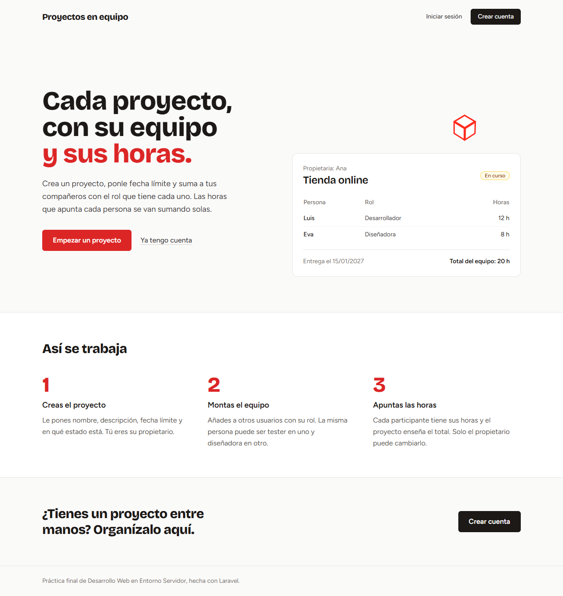 | 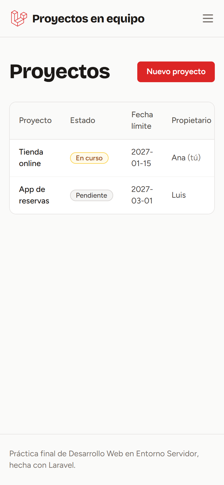 |

| Iniciar sesión | Registrarse |
|---|---|
| 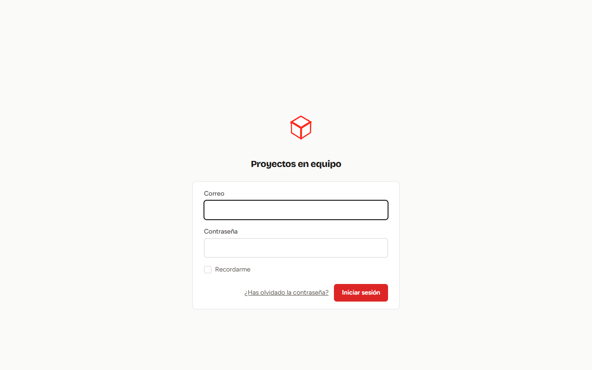 | 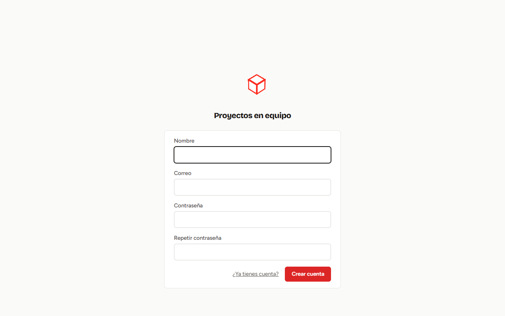 |

El logo de Laravel está hecho con CSS 3D y se mueve:


### Proyectos

| Lista de proyectos | Perfil (de Breeze, con el mismo estilo) |
|---|---|
| 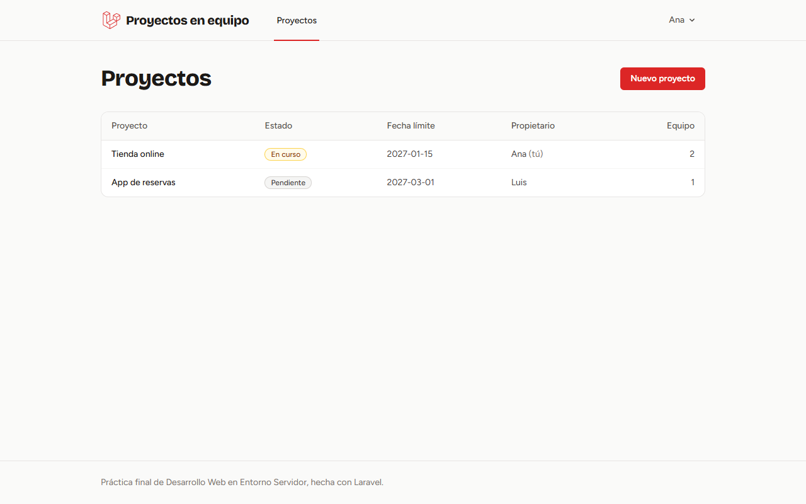 | 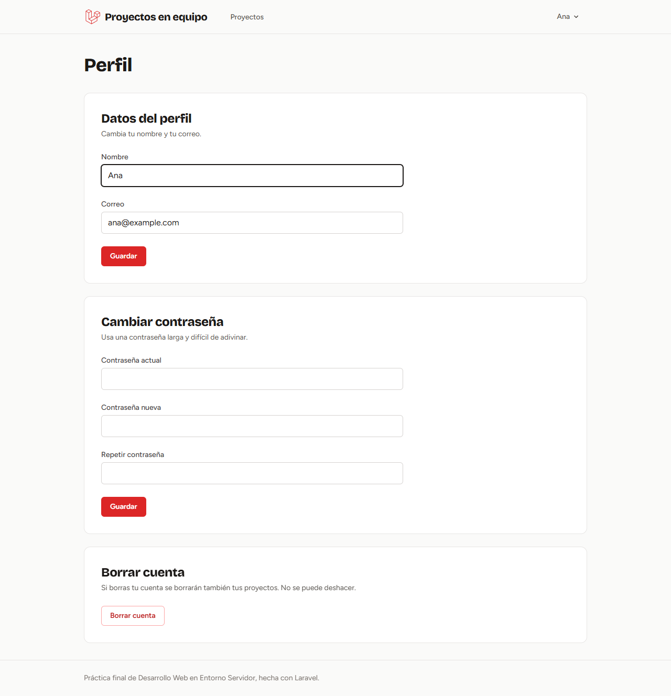 |

| Proyecto mío: puedo cambiar el equipo, editar y borrar | Proyecto de otro: no salen los botones |
|---|---|
| 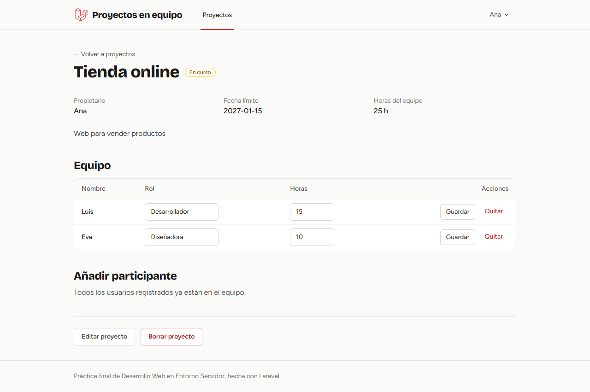 | 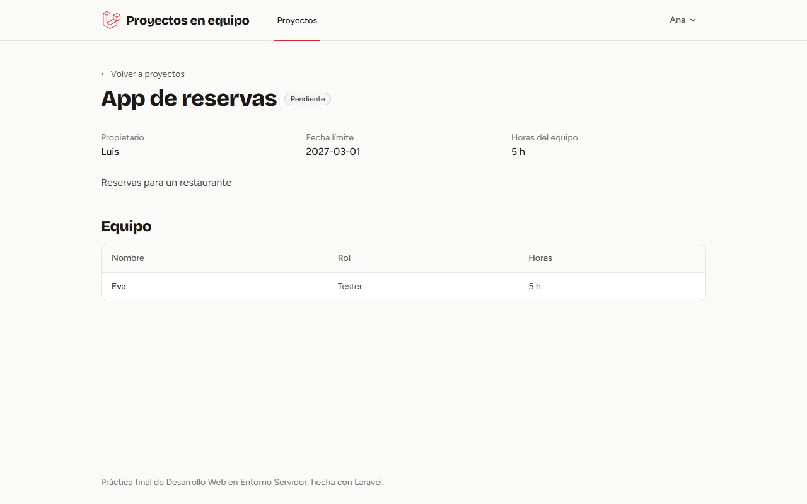 |

| Nuevo proyecto | Editar proyecto (`/projects/1/edit`) |
|---|---|
| 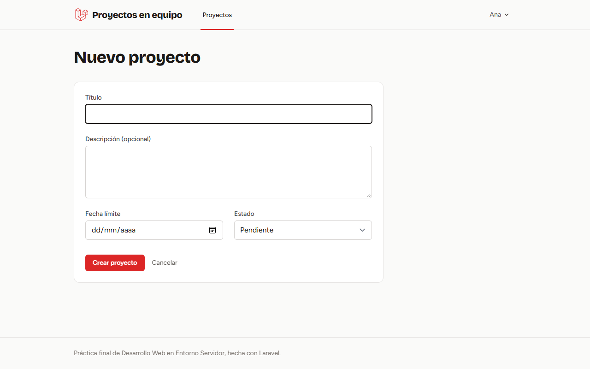 | 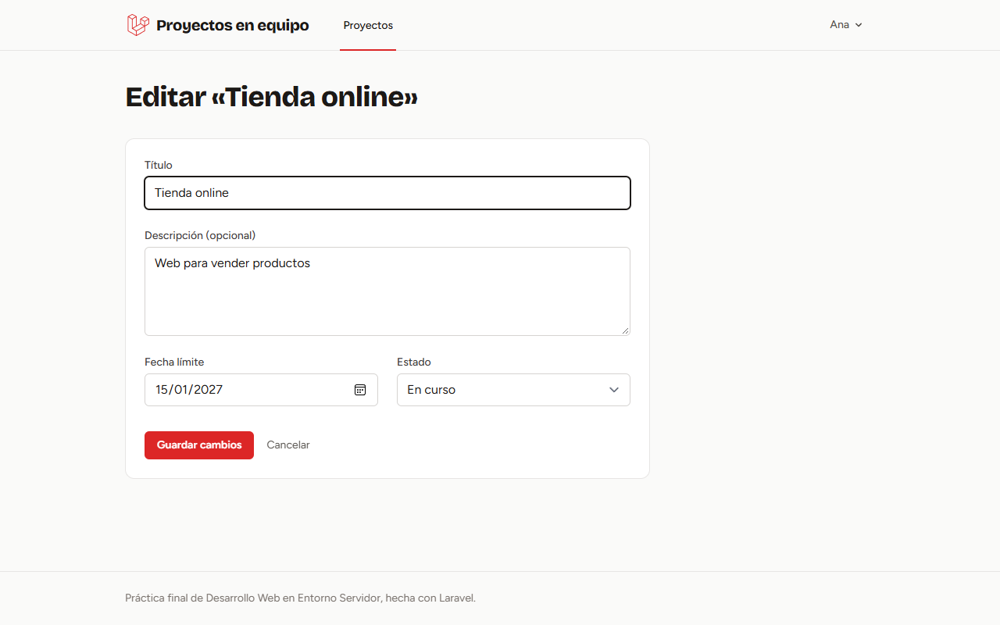 |

### Validación y errores

| Formulario enviado vacío | Editar un proyecto de otro (`/projects/2/edit`) |
|---|---|
| 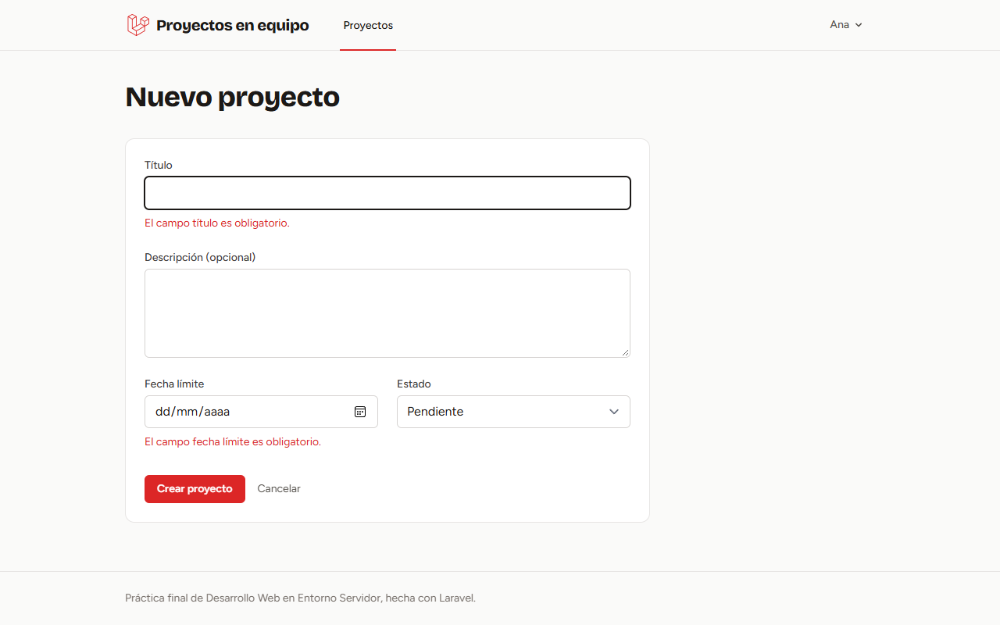 | 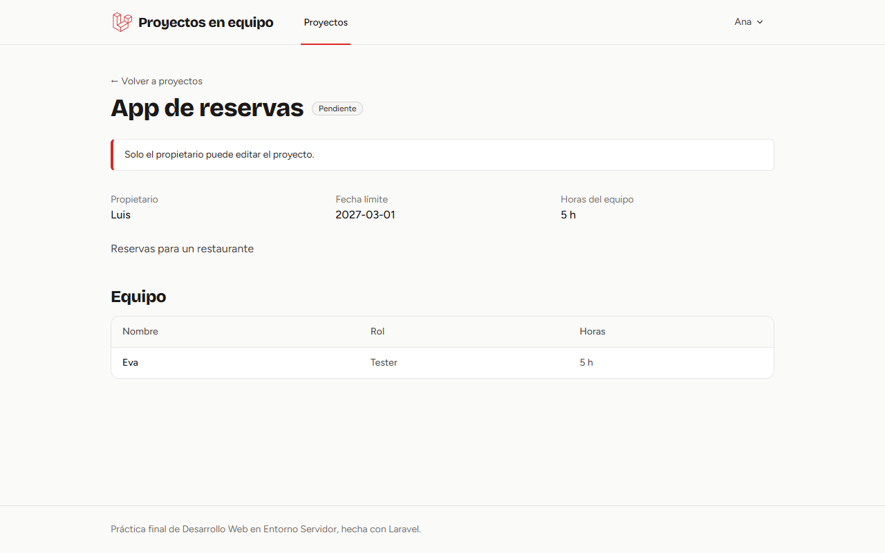 |

| 404: un proyecto que no existe (`/projects/999`) |
|---|
| 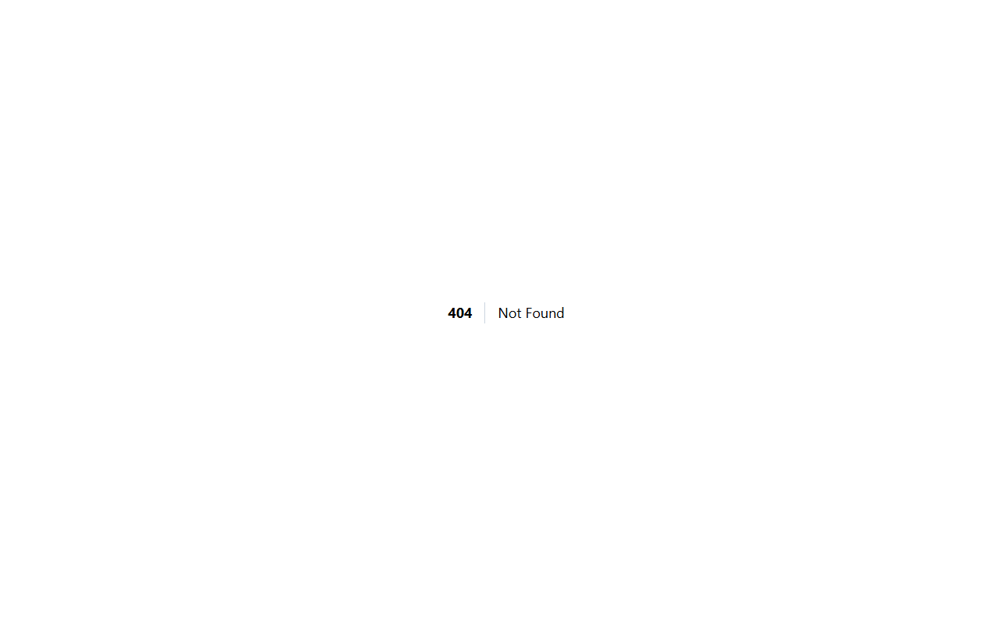 |

## Requisitos

- Docker Desktop instalado y **abierto** (en Windows, con la integración de WSL activada para Ubuntu).

## Cómo levantarla

```bash
./vendor/bin/sail up -d
./vendor/bin/sail artisan migrate --seed
```

Abrir http://localhost. El CSS ya está compilado en `public/build`, así que no hace falta `npm install` ni `npm run build`.

Para volver a dejar los datos como al principio:

```bash
./vendor/bin/sail artisan migrate:fresh --seed
```

## Usuarios de prueba

Los crea el seeder, todos con la contraseña `password`:

- `ana@example.com`: propietaria de "Tienda online".
- `luis@example.com`: propietario de "App de reservas".
- `eva@example.com`: participa en los dos proyectos.

## Base de datos

- `users`: usuarios (login con Breeze).
- `projects`: título, descripción, fecha límite, estado y propietario (`user_id`). Relación 1:N con `users`.
- `project_user`: tabla pivote con los participantes, su `role` y sus `contribution_hours`. Relación N:N entre `projects` y `users`.

## Estructura

```
app/Http/Controllers/ProjectController.php      CRUD de proyectos y comprobación del propietario
app/Http/Controllers/ParticipantController.php  añadir, editar y quitar participantes (attach / detach)
app/Models/Project.php                          relaciones owner() y participants()
app/Models/User.php                             relaciones ownedProjects() y projects()
database/migrations/                            tablas projects y project_user
database/seeders/ProjectSeeder.php              usuarios y proyectos de prueba
resources/views/layouts/app.blade.php           plantilla común (@yield)
resources/views/projects/                       vistas de proyectos (@extends, @include)
routes/web.php                                  Route::resource y rutas de participantes
docs/capturas/                                  capturas de la aplicación (las del README)
```
